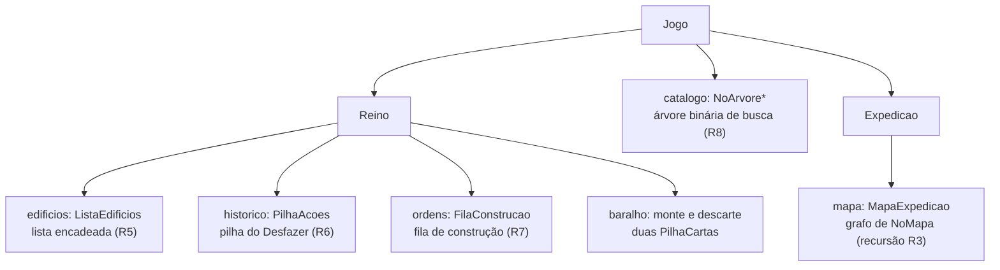

# Kingdoms: Ashes of the Fallen

Projeto Final de Programação e Sistemas Computacionais II — Centro Universitário Campo Real.

## Sobre o sistema

**Tema:** estratégia medieval de fantasia. O jogador é o governante de um reino pequeno cercado por
6 reinos inimigos (goblins, orcs, mortos-vivos, areias, elfos e cinzas). A ideia de cartas e reinos
inimigos veio do *9 Kings*, e as expedições seguem o estilo roguelike.

**O que o sistema faz:** é um jogo por turnos em C++, com janela gráfica feita em
[raylib](https://www.raylib.com/). A cada turno o jogador:

1. joga cartas pra construir e melhorar prédios no reino (fazendas, minas, quartéis, torres...);
2. administra os recursos (ouro, madeira, pedra, comida, ferro, população);
3. invoca heróis e manda o grupo em expedições por mapas com caminhos ramificados até o chefe da região;
4. encerra o turno: a produção entra, a fila de construção anda e um reino inimigo ataca o castelo.

Vence quem derrotar os 6 chefes. Se o castelo cair, a partida acaba e o **Novo jogo** libera toda a
memória da partida antiga antes de começar outra. Se o grupo cair numa expedição, o saque vai junto.
## Como compilar e executar

### Windows
1. Baixe e instale a raylib pelo instalador oficial (raylib.com → *Download* → *raylib installer for Windows*).
   Ele instala em `C:\raylib` e já traz o compilador junto.
2. Dê dois cliques em `compilar.bat` (ou rode ele pelo terminal dentro da pasta do projeto).

### Linux
Com a raylib instalada no sistema, é só rodar `make` e depois `./kingdoms`.

## Como jogar

O reino é uma grade 5x5 com o castelo no meio; no começo só o 3x3 central está aberto.

**Cartas.** Todo turno vem uma mão de 5 cartas tiradas do monte (44 cartas no começo).
Clique numa carta (ou aperte 1 a 5) e depois num lote. As cartas que sobram vão pro descarte
no fim do turno, e quando o monte acaba o descarte é embaralhado de volta.

| Tipo | Cartas | Como usa |
|---|---|---|
| Prédio | Fazenda, Serraria, Mina, Casa, Mercado, Muralha, Torre, Oficina | lote livre. Em cima de um igual, sobe de nível (até 3) |
| Tropa | Quartel, Arquearia, Estábulo, Torre Arcana | igual ao prédio; cada nível manda mais tropas pra batalha |
| Encanto | Lâminas, Armaduras, Estandarte, Bênção Real | em cima de um prédio (os três primeiros só em prédio de tropa) |
| Terreno | Expansão | abre um lote de floresta colado no reino |
| Instante | Caravana | clicou, usou |

Se faltar recurso pra um prédio, a carta vira uma ordem na fila de construção.

**Objetivo.** Derrotar os chefes dos 6 reinos nas expedições sem deixar o castelo cair.
No fim aparece o resumo da partida com a pontuação. `F1` abre a ajuda dentro do jogo.

**Batalha.** No fim de cada turno um dos 6 reinos inimigos ataca. A ordem é sorteada e muda
a cada volta, então em 6 turnos os 6 aparecem. O painel da direita mostra quem vem e a força da onda.
A cada 6 turnos vem um chefe.

| Reino | Tropas |
|---|---|
| Clã Goblin | goblin, goblin fundeiro, troll do pântano |
| Horda Orc | orc, orc lanceiro, chefe orc |
| Necrópole | esqueleto, arqueiro ossudo, cavaleiro da morte |
| Império das Areias | lanceiro de bronze, arqueiro do sol, guarda de bronze |
| Elfos Prateados | batedor, arqueiro élfico, druida antigo |
| Senhores das Cinzas | cultista, mago de fogo, draco das cinzas |

A batalha é automática e por rodadas: torres atiram, depois atacam os heróis e tropas do reino,
depois os inimigos. O dano é `ataque - defesa`, no mínimo 1. Se o exército cair, cada inimigo
que sobrou bate no castelo (as muralhas diminuem esse dano). Vencer dá ouro e cristais;
perder tira vida do castelo e parte do ouro. Castelo com 0 de vida = fim de jogo, e o
**Novo jogo** libera tudo da partida velha antes de começar outra.

**Expedição.** O botão **Expedição** manda a equipe de heróis pro território do reino que
vai atacar no turno (custa 15 de comida, uma por turno). O mapa é feito de nós ligados por
caminhos sorteados: combate, evento, tesouro, acampamento, elite e chefe. Sempre existe
caminho até o chefe (uma função recursiva confere isso depois de gerar o mapa).

- No combate o jogador escolhe a ação da rodada: **Atacar** (clique no inimigo pra escolher o alvo),
  **Defender** (metade do dano), **Poção** ou **Fugir**. Depois os inimigos vivos atacam.
- Nos eventos tem duas escolhas, cada uma com custo e ganho (caravana abandonada, altar antigo...).
- O saque (ouro, cristais e itens do catálogo) fica separado e só entra no reino se o grupo
  **voltar pra casa**. Se o grupo cair, o saque se perde e os heróis ficam feridos e não defendem.
- Os itens achados vêm do catálogo (árvore binária): armas e armaduras dão bônus aos heróis.

**Recompensa.** Depois de vencer a defesa, você escolhe 1 de 3 cartas pra entrar no baralho.

**Heróis.** Na tela **Heróis** (`H`) cada invocação custa 5 cristais. Chances: comum 60%,
raro 28%, épico 10%, lendário 2%, e a 10ª invocação sem épico vem épica. Herói repetido ganha
estrela (+25% de vida e ataque). Até 3 heróis vão pra batalha; clique num herói pra escalar ou tirar.

**Outros controles**

- **Recrutar**: 2 guardas do castelo por 20 de ouro (precisa de Quartel). Guarda que morre não volta.
- Botão direito em cima de um prédio demole e devolve metade do ouro.
- `Z` desfaz a última jogada do turno, e a carta volta pra mão.
- **Fim do turno** (ou `Espaço`): produção, fila e batalha. Na batalha, `Espaço` pula a animação.

Todo turno o povo paga 1 de ouro a cada 2 habitantes e come 1 de comida a cada
5 habitantes + 1 a cada 3 guardas. Se a comida acabar, parte do povo vai embora.

### Vista 3D

O mapa abre em **3D** (dá pra voltar pro 2D no botão **Vista 2D** ou na tecla `V`).

| Tecla | O que faz |
|---|---|
| `Q` / `E` ou `←` / `→` | gira o mapa |
| `W` / `S` ou `↑` / `↓` | inclina a câmera |
| roda do mouse | zoom |
| botão do meio + arrastar | gira com o mouse |
| `R` | volta a câmera pro começo |
| `F11` | sai da tela cheia (o jogo já abre nela) ou volta |
| `Z` | desfaz a última jogada do turno |
| `T` | paga ouro pra trocar a mão |
| `H` | heróis |
| `F1` | ajuda |
| `M` | liga/desliga o som |

A janela pode ser redimensionada à vontade.

## Andamento

- [x] Etapa 1 — esqueleto, menu principal e validação de entrada
- [x] Interface gráfica em pixel art — título, grade do reino, cartas e painéis
- [x] Cenário vivo — bosques com 5 tipos de árvore, vento, riacho, galinhas e fumaça
- [x] Resolução interna 640x360 com detalhes finos, contorno nos sprites e animações leves
- [x] Vista meio 3D com câmera que gira, janela redimensionável e tela cheia
- [x] Etapa 3 — economia (produção, consumo, construções)
- [x] Etapa 4 — lista encadeada de edifícios
- [x] Etapa 5 — pilha (desfazer) e fila de construção
- [x] Etapa 6 — catálogo de itens (árvore binária)
- [x] Etapa 7 — ordenação e buscas
- [x] Cartas com variantes, níveis de prédio e encantos
- [x] Heróis com invocação e equipe
- [x] Etapa 9 — combate contra os 6 reinos no fim de cada turno
- [x] Etapa 10 — derrota, novo jogo e liberação de memória
- [x] Etapa 8 — mapa da expedição, saque e combate por ações
- [x] Vitória com resumo e pontuação, carta de recompensa, ajuda (F1) e som
- [x] Etapa 11 — balanceamento com simulador (`simulador.cpp`)
- [x] Etapa 12 — README, [relatório técnico](RELATORIO.md) e apresentação

## Estruturas de dados

### Diagrama

Onde cada estrutura mora dentro do estado do jogo (`Jogo`, em `jogo.h`):



Como os nós se ligam (todos criados com `new` e liberados com `delete`, R4):

```
Lista (prédios)      primeiro -> [Fazenda] -> [Serraria] -> [Quartel] -> nullptr
                                                              ^ ultimo  (inserir no fim é O(1))

Pilha (Desfazer)     topo -> [subiu o Quartel] -> [construiu Fazenda] -> [abriu lote] -> nullptr
                             (sai primeiro o último que entrou: LIFO)

Fila (construção)    inicio -> [Fazenda] -> [Torre] -> [Mercado] -> nullptr
                                                        ^ fim  (entra no fim, sai do início: FIFO)

Árvore (catálogo)                    [50]
                                   /      \
                               [25]        [75]        menores à esquerda,
                              /    \       /   \       maiores à direita
                           [12]   [37]  [62]  [87]     (3 primeiros níveis de 4;
                                                        14 itens no total)

Mapa (expedição)     [entrada] -> [combate] -> [evento] -> ... -> [chefe]
                                \-> [tesouro] ----/            cada nó aponta pros próximos
```

### Onde cada uma é usada


- **Lista encadeada (R5)** — `estruturas.cpp`: os edifícios construídos. Inserção no fim em O(1)
  (guardamos o ponteiro do último nó), remoção por id tratando lista vazia / primeiro / meio / fim,
  travessia pra desenhar e somar a produção, e liberação de todos os nós ao sair.

- **Pilha (R6)** — `estruturas.cpp`: guarda as jogadas do turno (construir, subir nível, encanto, expansão...). O botão Desfazer (ou `Z`)
  tira do topo e desfaz. Quando vira o turno a pilha é limpa, porque a produção já aconteceu.
- **Fila (R7)** — `estruturas.cpp`: se faltar recurso, a construção entra na fila e é feita no fim do turno,
  na ordem em que entrou. A primeira ordem espera até ter recurso e as de trás não passam na frente;
  se o lote ficar ocupado, a ordem é cancelada.
- **Pilha de cartas** — `estruturas.cpp`/`cartas.cpp`: o monte de compra e o descarte. Pra embaralhar, a pilha
  é esvaziada num vetor, passa pelo Fisher-Yates e é empilhada de novo.
- **Árvore binária de busca (R8)** — `estruturas.cpp`: catálogo de 14 itens organizado por id, com inserção,
  busca e percurso in-ordem, todos recursivos (R3).

## Algoritmos

Na tela **Catálogo** (`algoritmos.cpp`):

- **Insertion sort (R9)** ordena por preço e mostra quantas comparações fez.
  Melhor caso O(n) (já ordenado), médio e pior caso O(n²), memória extra O(1).
- **Busca sequencial e binária (R10)** procuram o mesmo id e mostram as comparações de cada uma,
  junto com a busca na árvore. A binária usa o vetor ordenado por id (o in-ordem da árvore).

## Testes

`testes.cpp` testa as estruturas, a economia, as cartas, os heróis e a batalha sem abrir a janela.
A lógica usa um sorteio próprio com semente (`aleatorio.cpp`), então os testes dão sempre o mesmo resultado.

```
make testes && ./testes
```

## Demonstração no terminal

`demo.cpp` roda as estruturas e os algoritmos sem abrir a janela, usando as mesmas funções do jogo:
constrói e desfaz (lista + pilha), agenda construções sem recurso (fila), mostra a árvore do
catálogo, ordena por preço, compara as três buscas e roda um turno inteiro com batalha.
Também mede o tempo de 1000 buscas num vetor de 10 mil itens:

```
make demo && ./demo
```

Num notebook comum deu algo perto de 4 ms pra sequencial (10000 comparações por busca)
e 0,01 ms pra binária (14 comparações), com `-O2`.

## Balanceamento

Os números da economia ficam em `economia.h`. O `simulador.cpp` joga partidas inteiras com
quatro tipos de jogador (parado, casual, esperto e um que só defende) e dá uma nota pra cada
opção. A nota olha a taxa de vitória, o turno da vitória, quantas cartas dá pra jogar por turno,
quanto ouro fica parado e quantas vezes a mão trava por falta de material.

O rastro turno a turno (`simulador rastro 2`) mostrou que a primeira versão estava quebrada:
o saque das expedições enchia o reino de ouro (mais de 1.500 parados) e os chefes caíam nos
primeiros turnos, enquanto a madeira travava as cartas. A economia foi reestruturada:

- itens sem uso são vendidos por 20% do preço e o ouro do saque caiu pra um quarto
- o castelo rende um pouco de madeira, pedra e ferro todo turno, e os prédios pedem menos material
- subir de nível fica mais caro a cada nível, e dá pra pagar ouro pra trocar a mão (`T`)
- os inimigos das expedições já começam mais fortes

| | Antes | Agora |
|---|---|---|
| Jogador esperto vence | 94% | 62% |
| Jogador casual vence | 49% | 10% |
| Turno médio da vitória | 18 | 23 |
| Chefes derrotados até o turno 3 | 2,0 | 0,4 |
| Ouro parado por turno | 1.557 | 68 |
| Cartas travadas por falta de material | 1,34 | 0,39 |

### Dá pra terminar?

Pra conferir, 500 partidas novas de cada tipo de jogador (sementes diferentes das usadas no ajuste).
Os chefes dos 6 reinos têm atributos muito diferentes: antes, o 3º, 4º e 5º caíam quase sempre
e o último (Draco das Cinzas) segurava todo mundo. A vida de cada chefe agora é calibrada no
simulador (`chefeVidaPct` em `economia.h`) pra dificuldade subir aos poucos:

| Chefe | 1º | 2º | 3º | 4º | 5º | 6º |
|---|---|---|---|---|---|---|
| Antes: esperto vence quando enfrenta | 43% | 56% | 89% | 87% | 95% | 52% |
| Agora | 82% | 78% | 67% | 67% | 65% | 53% |

| Jogador | Vence | Vitória (metade das partidas até) | Quando perde, o castelo cai até |
|---|---|---|---|
| Esperto | 66% | turno 21 | turno 18 |
| Casual | 11% | turno 22 | turno 12 |
| Só defende | 0% (não faz expedição) | — | turno 19 |
| Parado | 0% | — | turno 7 |

Nenhuma partida trava: todas terminam em vitória ou derrota, menos 1 do esperto e 14 do casual,
que chegaram ao turno 60 com o castelo de pé mas sem derrotar todos os chefes.

## Organização do código

| Arquivo | O que tem |
|---|---|
| `main.cpp` | Ponto de entrada |
| `jogo.h/.cpp` | Estado da partida e regras de turno |
| `interface.h/.cpp` | Janela, tela do reino, catálogo e troca de telas (raylib) |
| `ui.h/.cpp` | Peças de tela usadas em todo lugar: caixas, botões, mouse |
| `tela_batalha.h/.cpp` | Tela da batalha: anima cada rodada |
| `tela_herois.h/.cpp` | Tela dos heróis: coleção, equipe e invocação |
| `figuras.h/.cpp` | Bonecos das tropas, heróis e inimigos |
| `fonte.h/.cpp` | Fonte própria em pixel art, com acentos |
| `sprites.h/.cpp` | Desenhos do castelo, construções e ícones |
| `natureza.h/.cpp` | Cenário vivo: árvores variadas, riacho, flores, galinhas e fumaça |
| `visao3d.h/.cpp` | Vista 3D: chão em relevo, câmera que gira e clique no mapa |
| `modelos3d.h/.cpp` | Construções e árvores em 3D, montadas com blocos, telhados e cones |
| `paleta.h` | Cores do jogo |
| `pincel.h/.cpp` | Retângulo em meia unidade, contorno fino dos sprites e escala das animações |
| `reino.h/.cpp` | Edifícios, jogadas das cartas, desfazer, fila e turno |
| `cartas.h/.cpp` | As 18 cartas e o baralho (monte, mão, descarte) |
| `herois.h/.cpp` | Os 9 heróis e a invocação |
| `inimigos.h/.cpp` | Os 6 reinos inimigos e a força das ondas |
| `aleatorio.h/.cpp` | Sorteio com semente |
| `expedicao.h/.cpp` | Mapa de nós, eventos, saque e combate por ações |
| `tela_expedicao.h/.cpp` | Tela da expedição |
| `economia.h` | Números de balanceamento num lugar só |
| `demo.cpp` | Demonstração no terminal das estruturas, buscas e um turno (não faz parte do jogo) |
| `simulador.cpp` | Joga centenas de partidas sozinho pra comparar economias (não faz parte do jogo) |
| `som.h/.cpp` | Efeitos sonoros montados no código |
| `combate.h/.cpp` | Batalha em rodadas, dano e recompensas |
| `estruturas.h/.cpp` | Lista encadeada, pilha, fila e árvore binária de busca |
| `algoritmos.h/.cpp` | Insertion sort, busca sequencial e busca binária |

## Integrantes e divisão de responsabilidades

| Integrante | Responsável por | Arquivos principais |
|---|---|---|
| **Eduarda** | Recursos e estado do reino; pilha do Desfazer e fila de construção; árvore do catálogo; ordenação e buscas; cenário em volta do reino; janela redimensionável e primeira versão da vista 3D | `reino`, `estruturas` (pilha, fila, árvore), `algoritmos`, `natureza`, `visao3d` |
| **Mateus** | Esqueleto do jogo e menus; interface em raylib e pixel art; lista encadeada dos prédios e economia do turno; cartas, heróis, batalha e os 6 reinos; expedição com mapa recursivo; som; simulador e balanceamento | `jogo`, `interface`, `ui`, `figuras`, `sprites`, `estruturas` (lista), `cartas`, `herois`, `inimigos`, `combate`, `expedicao`, `som`, `simulador` |
| **Os dois** | Testes (`testes.cpp`), README, relatório técnico e apresentação | — |

O histórico de commits mostra a parte de cada um.
